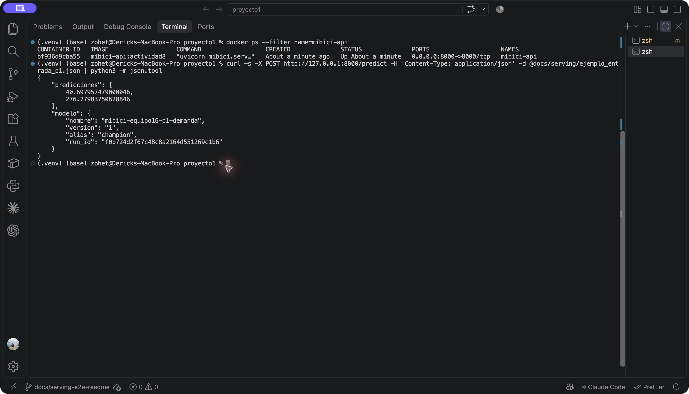
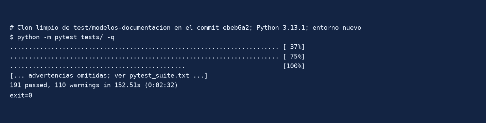
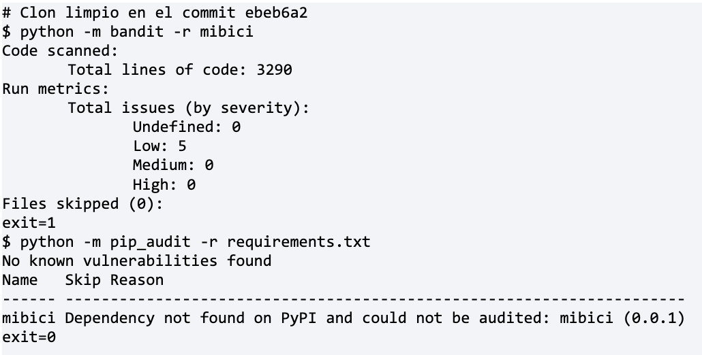

# TC5061-Proyecto-Equipo16

<a target="_blank" href="https://cookiecutter-data-science.drivendata.org/">
    
</a>

Predicción de demanda, riesgo de desabasto y clustering de estaciones de MiBici, el sistema de bicicleta
pública del Área Metropolitana de Guadalajara. Este repositorio es la base reproducible del proyecto
integrador de TC5061: ingesta versionada, variables sin fuga del futuro y un **MLflow Project** que
entrena, compara y lleva a producción un modelo por pregunta mediante el Model Registry.

## Preguntas

| | Pregunta | Tipo | Granularidad y horizonte | Usuario |
|---|---|---|---|---|
| **P1** | ¿Cuántos viajes iniciarán en cada estación mañana? | Regresión de conteos | Estación × día, D+1 | Operador del sistema |
| **P2** | ¿Qué estaciones corren riesgo de quedarse sin bicicletas o sin anclajes en la siguiente franja de 3 h? | Clasificación multiclase | Estación × franja de 3 h, siguiente franja | Equipo de rebalanceo |
| **P3** | ¿Qué tipos de estaciones existen según su patrón de uso? | Clustering | Una fila por estación | Planeación urbana |

MiBici no publica el inventario por estación, así que el riesgo de P2 es un **proxy**: una franja se
etiqueta `sin_bicicletas` si `salidas − llegadas ≥ α · capacidad` y `sin_anclajes` si
`salidas − llegadas ≤ −α · capacidad` (α = 0.5, franjas de 3 h). No es disponibilidad observada.

Detalle: [`references/propuesta-parte-a.md`](references/propuesta-parte-a.md),
[`references/ml-canvas.md`](references/ml-canvas.md) y [`references/arquitectura.md`](references/arquitectura.md).

## Datos

- **Fuente:** [datos abiertos de MiBici](https://mibici.net/es/datos-abiertos/) (viajes mensuales y
  nomenclatura de estaciones `nomenclatura_2026_09.csv`).
- **Rango:** octubre de 2024 a septiembre de 2026, 24 archivos mensuales, **9,043,925 viajes**
  (cifra del manifiesto) y 484 estaciones en la nomenclatura (470 activas; 357 GDL, 110 ZPN, 17 TLQ).
- **Partición temporal:** entrenamiento oct-2024 – mar-2026, validación abr – jun 2026 y prueba
  jul – sep 2026. Los cortes viven solo en [`mibici/config.py`](mibici/config.py).
- **Datos personales:** `Usuario_Id`, `Genero` y `Año_de_nacimiento` se eliminan durante la ingesta, antes
  de escribir Parquet. Solo se trabaja con agregados por estación.
- **Versión de los datos:** [`references/manifiesto_datos.json`](references/manifiesto_datos.json) guarda el
  SHA-256 y el número de filas de cada CSV; cada run de MLflow registra los primeros 12 caracteres del hash
  de ese manifiesto como `version_datos`.

## Estructura del repositorio

```
├── MLproject              <- MLflow Project: entradas ingest, train, register y predict
├── Containerfile          <- imagen OCI de la API (Docker o Podman) con el champion de P1 empaquetado
├── .dockerignore          <- contexto de build mínimo (sin datos, mlruns, mlflow.db ni .env)
├── python_env.yaml        <- entorno del proyecto (Python 3.13 + requirements.txt)
├── Makefile               <- atajos: make mlflow, data, baselines, train, register, predict, lint, test
├── README.md
├── model_bundle/          <- copia del champion exportada con make export-model (fuera de Git)
├── data/                  <- fuera de Git (raw: CSV descargados; processed: Parquet y predicciones)
├── docs/                  <- auditoría, contrato de serving (serving/) y evidencias
│   └── evidencias/
│       ├── pytest/        <- salidas y captura de pruebas y estilo
│       ├── deepchecks/    <- validación de datos
│       ├── seguridad/     <- auditoría de seguridad
│       └── actividad8/    <- API y contenedor: salidas reales, prueba E2E y captura
├── models/                <- reservado (los modelos viven en MLflow, fuera de Git)
├── notebooks/             <- 1.0-hh2-exploracion-viajes.ipynb
├── references/            <- propuesta, ML Canvas, arquitectura, plan y manifiesto de datos
├── reports/figures/       <- copia local de las gráficas (fuera de Git, salvo .gitkeep)
├── requirements.txt       <- dependencias con versión fija
├── requirements-dev.txt   <- herramientas de pruebas, calidad y seguridad
├── requirements-serving.txt <- dependencias mínimas de la imagen de la API
├── scripts/smoke_container.sh <- build, run y prueba E2E del contenedor
├── pytest.ini             <- marcas y ejecución estricta de pytest
├── tests/                 <- pruebas con datos sintéticos y MLflow temporal (pytest)
└── mibici/
    ├── compat.py          <- compatibilidad de dependencias para DeepChecks
    ├── validation/        <- contratos de calidad e integridad de datos
    ├── config.py          <- única fuente de rutas, fechas, semillas, hiperparámetros y nombres del registry
    ├── dataset.py         <- entrada ingest: descarga, normalización, datos personales fuera y manifiesto
    ├── features.py        <- limpieza, objetivos y variables de P1, P2 y P3; partición temporal
    ├── serving/           <- model_loader.py, exportar.py (champion -> model_bundle), api.py y schemas.py
    ├── tracking.py        <- corridas de MLflow con tags, parámetros obligatorios y nested runs
    ├── plots.py           <- figuras que se registran como artefactos
    └── modeling/
        ├── comun.py       <- ejecución de una corrida: búsqueda anidada, artefactos, firma y costo
        ├── p1_demanda.py  <- recetas de P1: naive, promedio, hgb
        ├── p2_riesgo.py   <- recetas de P2: persistencia, dummy, logistica, hgb, rf
        ├── p3_clusters.py <- recetas de P3: municipio, kmeans (v1/v2), gmm, ward
        ├── comparar.py    <- entrada compare: tablas comparativas por pregunta
        ├── train.py       <- entrada train
        ├── registro.py    <- entrada register: Model Registry con aliases champion/challenger
        └── predict.py     <- entrada predict: usa models:/<nombre>@champion
```

## Instalación

Requiere Python 3.13, `make` y [`uv`](https://docs.astral.sh/uv/) (lo usa `mlflow run` para crear el
entorno de `python_env.yaml`).

```bash
git clone https://github.com/CristhianHernandez/TC5061-Proyecto-Equipo16.git
cd TC5061-Proyecto-Equipo16
python3.13 -m venv .venv          # Windows: py -3.13 -m venv .venv
source .venv/bin/activate         # Windows: .venv\Scripts\activate
make requirements                 # pip install -r requirements.txt (incluye mlflow y el paquete mibici)
python -m pip install -r requirements-dev.txt
cp .env.example .env              # Windows: copy .env.example .env
```

El entorno activado solo se usa para lanzar `mlflow run` y el servidor; cada corrida se ejecuta en el
entorno que `mlflow run --env-manager uv` crea a partir de `python_env.yaml` (mismas versiones fijas).
`.env` solo contiene la URI de MLflow y nunca se sube a Git.

## Reproducir con el MLflow Project

Todas las corridas se lanzan con `mlflow run` desde la raíz del repositorio, nunca desde un notebook.
El `MLproject` declara el entorno y cuatro entradas; sus parámetros vacíos se resuelven con
[`mibici/config.py`](mibici/config.py), así que no repite rutas, fechas, semillas ni hiperparámetros.

| Entrada | Qué hace | Parámetros |
|---|---|---|
| `ingest` | Descarga los 24 meses y la nomenclatura, genera Parquet y el manifiesto de datos | — |
| `train` | Entrena **un** modelo de una pregunta (o una búsqueda con nested runs) y lo registra | `question`, `model`, `stage`, `search` e hiperparámetros |
| `register` | Registra el modelo elegido y le asigna el alias `champion` | `question`, `run_id` (vacío: propone el mejor en validación) |
| `predict` | Carga `models:/<nombre>@champion` y predice el conjunto de prueba | `question` |
| `compare` | Escribe `reports/tabla_comparativa_p1.csv`, `p2` y `p3` a partir del experimento (fuera de Git) | — |

### 1. Servidor de tracking (en otra terminal)

El Model Registry requiere un almacenamiento respaldado por base de datos, así que el servidor usa SQLite:

```bash
make mlflow    # mlflow server --backend-store-uri sqlite:///mlflow.db --default-artifact-root ./mlruns --host 0.0.0.0 --port 5000
```

`mlflow.db` (corridas y registry) y `./mlruns/` (artefactos) quedan fuera de Git. Abre
<http://127.0.0.1:5000> y elige el experimento `mibici-equipo16`.

### 2. Apuntar los comandos al servidor

```bash
export MLFLOW_TRACKING_URI=http://127.0.0.1:5000   # Windows (PowerShell): $env:MLFLOW_TRACKING_URI="http://127.0.0.1:5000"
```

Los atajos de `make` ya lo hacen. Siempre se pasa `--experiment-name mibici-equipo16`: si una corrida se
abre en otro experimento, el código se detiene con un error.

### 3. Ingesta, baselines y candidatos

```bash
mlflow run . -e ingest --env-manager uv --experiment-name mibici-equipo16

# Baselines de referencia (sin -P model se entrena el baseline de la pregunta)
mlflow run . -e train --env-manager uv --experiment-name mibici-equipo16 -P question=p1
mlflow run . -e train --env-manager uv --experiment-name mibici-equipo16 -P question=p2
mlflow run . -e train --env-manager uv --experiment-name mibici-equipo16 -P question=p3

# Un candidato con hiperparámetros explícitos
mlflow run . -e train --env-manager uv --experiment-name mibici-equipo16 \
  -P question=p1 -P model=hgb -P learning_rate=0.05 -P max_leaf_nodes=63

# Búsqueda de hiperparámetros como nested runs (rejilla en config.REJILLAS)
mlflow run . -e train --env-manager uv --experiment-name mibici-equipo16 \
  -P question=p1 -P model=hgb -P search=true

# Candidatas de P1 (la primera reproduce la mejor combinación de la búsqueda)
mlflow run . -e train --env-manager uv --experiment-name mibici-equipo16 \
  -P question=p1 -P model=hgb -P stage=candidate -P features=v1 \
  -P learning_rate=0.05 -P max_leaf_nodes=63 -P max_iter=100
mlflow run . -e train --env-manager uv --experiment-name mibici-equipo16 \
  -P question=p1 -P model=rf -P n_estimators=300 -P max_depth=none
mlflow run . -e train --env-manager uv --experiment-name mibici-equipo16 \
  -P question=p1 -P model=poisson -P alpha=1.0 -P max_iter=1000
mlflow run . -e train --env-manager uv --experiment-name mibici-equipo16 \
  -P question=p1 -P model=hgb -P features=v2

# P2: búsquedas como nested runs (rejillas en config.REJILLAS) y candidatas elegidas en validación
mlflow run . -e train --env-manager uv --experiment-name mibici-equipo16 \
  -P question=p2 -P model=hgb -P search=true
mlflow run . -e train --env-manager uv --experiment-name mibici-equipo16 \
  -P question=p2 -P model=logistica -P search=true
mlflow run . -e train --env-manager uv --experiment-name mibici-equipo16 \
  -P question=p2 -P model=rf -P search=true
mlflow run . -e train --env-manager uv --experiment-name mibici-equipo16 \
  -P question=p2 -P model=hgb -P learning_rate=0.1 -P class_weight=none -P max_iter=300
mlflow run . -e train --env-manager uv --experiment-name mibici-equipo16 \
  -P question=p2 -P model=logistica -P C=0.1
mlflow run . -e train --env-manager uv --experiment-name mibici-equipo16 \
  -P question=p2 -P model=rf -P n_estimators=200 -P max_depth=15 -P class_weight=none

# P3: búsqueda de k (2 a 8; cada hija mide además el ARI entre 3 semillas) y candidatas
mlflow run . -e train --env-manager uv --experiment-name mibici-equipo16 \
  -P question=p3 -P model=kmeans -P search=true
mlflow run . -e train --env-manager uv --experiment-name mibici-equipo16 -P question=p3 -P model=kmeans -P k=2
mlflow run . -e train --env-manager uv --experiment-name mibici-equipo16 -P question=p3 -P model=kmeans -P k=3
mlflow run . -e train --env-manager uv --experiment-name mibici-equipo16 -P question=p3 -P model=kmeans -P k=2 -P features=v2
mlflow run . -e train --env-manager uv --experiment-name mibici-equipo16 -P question=p3 -P model=kmeans -P k=3 -P features=v2
mlflow run . -e train --env-manager uv --experiment-name mibici-equipo16 \
  -P question=p3 -P model=gmm -P n_components=2 -P covariance_type=diag
mlflow run . -e train --env-manager uv --experiment-name mibici-equipo16 \
  -P question=p3 -P model=gmm -P n_components=3 -P covariance_type=diag
mlflow run . -e train --env-manager uv --experiment-name mibici-equipo16 \
  -P question=p3 -P model=gmm -P n_components=3 -P covariance_type=spherical
mlflow run . -e train --env-manager uv --experiment-name mibici-equipo16 -P question=p3 -P model=ward -P k=2
mlflow run . -e train --env-manager uv --experiment-name mibici-equipo16 -P question=p3 -P model=ward -P k=3

# Model Registry y uso del modelo en producción
mlflow run . -e register --env-manager uv --experiment-name mibici-equipo16 -P question=p1
mlflow run . -e predict  --env-manager uv --experiment-name mibici-equipo16 -P question=p1

# Tablas comparativas de las tres preguntas (reports/tabla_comparativa_p*.csv)
mlflow run . -e compare --env-manager uv --experiment-name mibici-equipo16
```

Atajos equivalentes: `make data`, `make baselines`, `make train QUESTION=p1 MODEL=hgb`,
`make register QUESTION=p1`, `make predict QUESTION=p1` y `make compare`. Si `uv` no está disponible, se puede usar el
entorno activado con `ENV_MANAGER=local` (o `--env-manager local`).

Modelos disponibles por pregunta (los baselines no aceptan hiperparámetros):

| Pregunta | Baselines | Candidatos (hiperparámetros) | Búsqueda (`search=true`) |
|---|---|---|---|
| `p1` | `naive` (referencia), `promedio` | `hgb` (`features`, `learning_rate`, `max_leaf_nodes`, `max_iter`), `rf` (`n_estimators`, `max_depth`), `poisson` (`alpha`, `max_iter`) | `hgb` (8 hijas) |
| `p2` | `persistencia` (referencia), `dummy` | `logistica` (`C`), `hgb` (`learning_rate`, `class_weight`, `max_iter`, `max_leaf_nodes`), `rf` (`n_estimators`, `max_depth`, `class_weight`) | `hgb`, `logistica`, `rf` |
| `p3` | `municipio` (referencia) | `kmeans` (`k`, `features`), `gmm` (`n_components`, `covariance_type`), `ward` (`k`, solo comparación: no tiene `predict`) | `kmeans` (k de 2 a 8) |

### Modelo en producción de cada pregunta

Comandos para reproducir el modelo elegido desde un clon limpio (después de `ingest` y del baseline):

| Pregunta | Modelo registrado | Corrida que lo produce | Registro |
|---|---|---|---|
| P1 | `mibici-equipo16-p1-demanda@champion` | HGB Poisson `features=v1`, `learning_rate=0.05`, `max_leaf_nodes=63`, `max_iter=100` | `-e register -P question=p1` |
| P2 | `mibici-equipo16-p2-riesgo@champion` | HGB `learning_rate=0.1`, `class_weight=none`, `max_iter=300` | `-e register -P question=p2` |
| P3 | `mibici-equipo16-p3-grupos@champion` | KMeans `features=v2`, `k=2` | `-e register -P question=p3` |

La selección automática de P1 considera sólo candidatas que mejoran al naive en prueba. Entre las
que difieren menos de 2 % del menor `val_mae`, elige primero menor desviación mensual del MAE y
después menor tiempo de entrenamiento y latencia. En la corrida local de referencia, RF obtuvo
`val_mae=6.082826` y HGB `6.136672` (diferencia de 0.89 %); HGB fue más estable
(`0.741989` frente a `0.751491`) y más barato (`1.4 s` frente a `275.8 s` de entrenamiento).

En P2, `register` sin `run_id` elige la candidata con mayor `val_f1_macro`: HGB (`0.530071`) frente a
Random Forest (`≈0.498`) y regresión logística (`0.359038`). Ninguna supera al baseline de persistencia
(`test_f1_macro=0.567355` frente a `0.535265` de HGB), así que la versión registrada queda con la tag
`supera_baseline=no` y se documenta como candidata experimental; el análisis completo está en
[`reports/p2_resultados.md`](reports/p2_resultados.md).

### P3: variables, métricas y regla de selección

- **Volúmenes por día.** Los totales de cada perfil se expresan en viajes por día del periodo: train cubre
  18 meses y validación y prueba 3, así que los conteos brutos desplazarían los perfiles posteriores al
  asignarlos con `predict`.
- **Variantes de variables.** `features=v1` usa los 96 perfiles horarios, log-volúmenes, balance relativo y
  duración media; `features=v2` quita los log-volúmenes para agrupar solo por la forma del uso.
- **Métricas comparables.** Silueta (principal), Davies-Bouldin y Calinski-Harabasz se calculan siempre en
  el espacio v1 con la escala de train, aunque el modelo agrupe con v2. `val_silueta` y `test_silueta`
  aplican las etiquetas de train a los perfiles del periodo; `val_ari_periodo` y `test_ari_periodo`
  comparan esas etiquetas con las que asigna el modelo, y `train_ari_semillas` mide la estabilidad entre 3
  inicializaciones.
- **Regla de selección (`register` sin `run_id`).** Candidata con `predict` (KMeans o GMM; Ward no puede
  asignar estaciones nuevas), `train_ari_semillas >= 0.8` y silueta de train positiva; gana la mayor
  `val_silueta` y un empate (menos de 0.005) se decide por `val_ari_periodo` y luego por costo.

### macOS: puerto 5000 ocupado por AirPlay

En macOS el puerto 5000 lo usa AirPlay Receiver (el navegador recibe un 403). Usa otro puerto en el
servidor y en los comandos:

```bash
make mlflow MLFLOW_PORT=5001
export MLFLOW_TRACKING_URI=http://127.0.0.1:5001   # o: make train MLFLOW_PORT=5001 ...
```

## Qué registra cada corrida

Cada corrida se abre con `mibici.tracking.iniciar_run()` (bajo `mlflow run` reanuda la corrida que crea
MLflow) y registra:

- **Tags para filtrar y comparar:** `question` (p1/p2/p3), `model_family` (naive, linear, boosting,
  clustering…), `stage_of_work` (`baseline`, `search`, `candidate`), además de las obligatorias `equipo`,
  `pregunta`, `git_commit` (con sufijo `-sucio` si había cambios sin commit) y `version_datos`.
- **Parámetros:** fechas de inicio y de corte, `version_datos`, `semilla` y los hiperparámetros reales.
- **Métricas** con prefijo de conjunto (`train_`, `val_`, `test_`): las mismas de la entrega anterior
  (P1: MAE, RMSE, desviación Poisson; P2: F1 macro, recall por clase, AP y balanced accuracy; P3: silueta,
  Davies-Bouldin, Calinski-Harabasz, ARI), más:
  - **costo:** `train_duracion_s` y `test_latencia_ms_por_1000`;
  - **estabilidad:** desviación estándar mensual de la métrica principal en prueba (P1 y P2) o ARI entre
    semillas (P3);
  - **mejora contra el baseline de referencia:** `test_mejora_<métrica>_pct` y la tag `baseline_run_id`.
- **Artefactos en subcarpetas:**

| Carpeta | Contenido |
|---|---|
| `data/` | `manifiesto_datos.json` (versión de los datos) y el conjunto de entrenamiento con `mlflow.log_input` (solo variables agregadas por estación) |
| `config/` | `config_efectiva.json` (valores usados de `config.py` y del `mlflow run`), `MLproject`, `python_env.yaml`, `requirements.txt` y `config.py` |
| `plots/` | Real contra predicho, residuales y error por estación (P1); matrices de confusión (P2); mapa, perfiles y silueta por grupo (P3) |
| `metrics/` | `metricas.json` y la tabla de la búsqueda (`busqueda.csv`); la corrida de `compare` guarda las tablas comparativas |
| `model/` | Modelo con firma (`signature`) y ejemplo de entrada; también como LoggedModel de MLflow 3 |

Las búsquedas (`search=true`) crean una corrida padre y una hija por combinación. Las hijas solo registran
métricas de entrenamiento y validación; la padre registra la mejor combinación (elegida en validación), su
evaluación en prueba, sus artefactos y su modelo. La partición temporal es la misma de la entrega anterior,
así que toda corrida es comparable con su baseline.

## Esquema del Model Registry: aliases

Usamos **aliases** y no etapas (*stages*). Las etapas `Staging`/`Production` están obsoletas desde
MLflow 2.9 y la documentación recomienda aliases y tags. Además:

- `champion` marca la versión en producción y `challenger` conserva la versión que reemplazó: comparar o
  revertir es solo reasignar un alias, sin volver a registrar nada.
- El código que consume el modelo carga siempre `models:/<nombre>@champion` (ver `predict.py`) y no cambia
  cuando se promueve otra versión.
- Cada versión guarda su linaje en tags (`experimento`, `run_id`, `git_commit`, `version_datos`, métrica
  de validación) y una descripción; cada modelo registrado tiene la descripción de su pregunta.

| Pregunta | Modelo registrado |
|---|---|
| P1 | `mibici-equipo16-p1-demanda` |
| P2 | `mibici-equipo16-p2-riesgo` |
| P3 | `mibici-equipo16-p3-grupos` |

Para verificar que el modelo en producción carga por nombre y alias:

```python
import mlflow
mlflow.set_tracking_uri("http://127.0.0.1:5000")
modelo = mlflow.pyfunc.load_model("models:/mibici-equipo16-p1-demanda@champion")
```

Los modelos de scikit-learn se guardan con el formato seguro `skops`; solo se declaran como confiables los
tipos de scikit-learn, numpy y del paquete `mibici`.

## Servicio de inferencia: API REST en contenedor

El champion de P1 (demanda diaria por estación) se sirve como API REST con **FastAPI + Pydantic**
dentro de una imagen OCI que corre en **Docker o Podman**. El contrato completo de entrada y salida
está en [`docs/serving/contrato_p1.md`](docs/serving/contrato_p1.md).

| Campo | Valor |
|---|---|
| Modelo | `mibici-equipo16-p1-demanda` (`HistGradientBoostingRegressor`, pérdida Poisson) |
| URI | `models:/mibici-equipo16-p1-demanda@champion` |
| Versión | La que resuelve el alias al exportar; queda fija en `model_bundle/modelo_servido.json` y la reporta `/health` |
| Entrada | 11 variables numéricas por registro (calendario, rezagos de demanda y estación) |
| Salida | Viajes esperados por registro (`float` > 0), en el mismo orden |
| Endpoints | `GET /health`, `POST /predict`, `GET /docs` (Swagger) y `GET /openapi.json` |

### Estrategia: modelo empaquetado en la imagen

`make export-model` resuelve `@champion` a una versión concreta del Model Registry, la descarga a
`model_bundle/` (ignorada por Git, incluida en el contexto de build) y comprueba que predice el ejemplo
del contrato. El `Containerfile` copia esa carpeta en `/app/model_bundle` (`MODEL_PATH`) y la API la
carga una sola vez al arrancar. Así:

- la inferencia **no depende del servidor de MLflow** ni de las rutas absolutas de artefactos que guarda
  el registry local de cada integrante;
- un cambio posterior del alias no altera en silencio una imagen ya construida: para servir otro champion
  se vuelve a exportar y a construir;
- si no hay `model_bundle/`, el loader intenta `MODEL_URI` contra `MLFLOW_TRACKING_URI` (alternativa no
  usada en la imagen).

**¿Por qué tiempo real y no lotes?** P1 responde a una pregunta operativa puntual (cuántos viajes
esperar hoy en una estación) que consultan aplicaciones de rebalanceo o tableros en el momento en que
se planea una ruta; cada petición es ligera (11 variables, milisegundos) y el resultado se necesita de
inmediato. El proceso por lotes (`make predict`, entrada `predict` del MLflow Project) se mantiene para
puntuar el conjunto de prueba completo y generar reportes.

### Prerrequisitos

- Docker 24+ o Podman 4+ (validado con Docker 27.4 en macOS arm64).
- El entorno del proyecto instalado (ver [Instalación](#instalación)) y el Model Registry con el champion
  de P1 (`make mlflow` y la secuencia de [registro](#reproducir-con-el-mlflow-project)).
- Puerto 8000 libre en el host.

### 1. Exportar el champion

```bash
make mlflow                     # en otra terminal; en macOS: make mlflow MLFLOW_PORT=5001
make export-model               # en macOS: make export-model MLFLOW_PORT=5001
```

Imprime el modelo y la predicción del ejemplo, por ejemplo:

```json
{
  "modelo": {"nombre": "mibici-equipo16-p1-demanda", "version": "1", "alias": "champion", "run_id": "f0b724d2f67c48c8a2164d551269c1b6"},
  "predicciones": [40.697957479000046, 276.77983750628846]
}
```

### 2. Construir y arrancar el contenedor

```bash
# Docker (con Podman, sustituir docker por podman; los argumentos son iguales)
docker build -t mibici-api:actividad8 -f Containerfile .
docker run --rm --name mibici-api -p 8000:8000 mibici-api:actividad8
```

La imagen parte de `python:3.13-slim`, instala solo `requirements-serving.txt`, corre como usuario sin
privilegios (`appuser`) y expone Uvicorn en `0.0.0.0:8000`. Para detenerla: `Ctrl+C` o
`docker stop mibici-api` desde otra terminal (`--rm` elimina el contenedor al detenerse).

### 3. Probar desde el host

```bash
curl -i http://127.0.0.1:8000/health

curl -i -X POST http://127.0.0.1:8000/predict \
  -H 'Content-Type: application/json' \
  -d @docs/serving/ejemplo_entrada_p1.json
```

Petición ([`docs/serving/ejemplo_entrada_p1.json`](docs/serving/ejemplo_entrada_p1.json), estaciones 55 y
51 el 30 de septiembre de 2026, datos de prueba sin información personal):

```json
{
  "registros": [
    {"dia_semana": 2, "mes": 9, "es_fin_semana": 0, "dia_anio": 273, "es_festivo": 0,
     "demanda_lag_1": 40.0, "demanda_lag_7": 29.0, "demanda_media_7": 37.714286,
     "capacidad": 15, "latitud": 20.675401, "longitud": -103.345665},
    {"dia_semana": 2, "mes": 9, "es_fin_semana": 0, "dia_anio": 273, "es_festivo": 0,
     "demanda_lag_1": 403.0, "demanda_lag_7": 375.0, "demanda_media_7": 398.142857,
     "capacidad": 39, "latitud": 20.67414, "longitud": -103.355535}
  ]
}
```

Respuesta real del contenedor (`HTTP/1.1 200 OK`):

```json
{
  "predicciones": [40.697957479000046, 276.77983750628846],
  "modelo": {
    "nombre": "mibici-equipo16-p1-demanda",
    "version": "1",
    "alias": "champion",
    "run_id": "f0b724d2f67c48c8a2164d551269c1b6"
  }
}
```

La demanda observada ese día fue de 32 y 442 viajes. `version` y `run_id` dependen del registry
donde se exportó (en el registry de CH1 el champion es la versión 2, con las mismas predicciones).

| Endpoint | Respuesta |
|---|---|
| `GET /health` | `200 {"estado": "listo", "modelo": {...}}`; `503 {"estado": "no_disponible"}` si el modelo no cargó o su firma no coincide con el contrato |
| `POST /predict` | `200` con una predicción por registro; `422` si falta una variable, sobra una, el tipo es incorrecto o está fuera de dominio (por ejemplo `mes: 13`); `500` controlado si falla la inferencia, sin trazas ni rutas |
| `GET /docs` | Swagger UI para probar la API desde el navegador: <http://127.0.0.1:8000/docs> |

Los rezagos (`demanda_lag_1`, `demanda_lag_7`, `demanda_media_7`) son opcionales: se envían como
`null` o se omiten cuando no hay historial.

### 4. Prueba extremo a extremo contra el contenedor

```bash
bash scripts/smoke_container.sh            # build, run, curl, pytest E2E y detención
SIN_BUILD=1 bash scripts/smoke_container.sh   # reutiliza la imagen ya construida

# o con el contenedor ya en ejecución:
MIBICI_API_URL=http://127.0.0.1:8000 python -m pytest tests/test_serving_e2e.py -q -m contenedor
```

`tests/test_serving_e2e.py` llama por HTTP al contenedor real: salud, predicción con el ejemplo del
contrato, un registro sin rezagos y seis entradas inválidas que deben dar 422. Sin `MIBICI_API_URL` el
módulo se omite, así que `python -m pytest tests/ -q` no requiere el contenedor.

### Variables de entorno

| Variable | En la imagen | Uso |
|---|---|---|
| `MODEL_PATH` | `/app/model_bundle` | Copia local del modelo que carga la API |
| `MODEL_URI` | `models:/mibici-equipo16-p1-demanda@champion` | Modelo del registry si no hay copia local (solo al exportar o en desarrollo) |
| `MLFLOW_TRACKING_URI` | no se usa | Servidor de MLflow para `make export-model` |
| `MIBICI_API_URL` | — | URL de la API para la prueba E2E |

### Solución de problemas

| Síntoma | Causa y solución |
|---|---|
| `COPY model_bundle/ ...: not found` al construir | Falta exportar el modelo: `make export-model` antes del build |
| `make export-model` no conecta o el navegador da 403 en el 5000 | AirPlay ocupa el puerto en macOS: `make mlflow MLFLOW_PORT=5001` y `make export-model MLFLOW_PORT=5001` |
| `RESOURCE_DOES_NOT_EXIST` al exportar | El registry no tiene `@champion` de P1: ejecutar la entrada `register` de P1 |
| `/health` responde 503 | El modelo no cargó; revisar `docker logs mibici-api` (sin `model_bundle/MLmodel` o firma distinta al contrato) |
| `Bind for 0.0.0.0:8000 failed` | Puerto ocupado: `-p 8080:8000` y usar `http://127.0.0.1:8080` |
| `Cannot connect to the Docker daemon` | Abrir Docker Desktop o `podman machine start` |
| Aviso `mlflow==3.17.1` requerido en los logs | El modelo se registró con 3.17.1 y la imagen usa 3.17.2 (corrección de CVE); es de parche y no cambia las predicciones |

### Evidencia de ejecución en contenedor

Salidas reales en [`docs/evidencias/actividad8/contenedor/`](docs/evidencias/actividad8/contenedor/):
`ejecucion_contenedor.txt` (build, `docker ps`, usuario, `curl` de `/health`, `/predict`, 422 y `/docs`),
`logs_contenedor.txt`, `respuesta_predict.json` y `pytest_e2e.txt`.



### PR de la entrega de serving

| Contribución | Responsable | Revisión |
|---|---|---|
| [PR #15](https://github.com/CristhianHernandez/TC5061-Proyecto-Equipo16/pull/15): champion, contrato y loader de MLflow | CH1 - Cristhian | Revisó LH3 |
| [PR #16](https://github.com/CristhianHernandez/TC5061-Proyecto-Equipo16/pull/16): FastAPI, esquemas Pydantic y pruebas HTTP | LH3 - Luis | Revisa HH2 |
| [PR #17](https://github.com/CristhianHernandez/TC5061-Proyecto-Equipo16/pull/17): Containerfile y dependencias de serving | HH2 - Horacio | Revisó DH4 |
| PR de la rama `docs/serving-e2e-readme`: prueba E2E, README y evidencias | DH4 - Derick | Revisa CH1 |

## Pruebas y estilo

Desde la raíz, con Python 3.13 y las dependencias de desarrollo instaladas:

```bash
# Comando único de la suite
python -m pytest tests/ -q
# Modelos P1-P3 y selecciones por marca
python -m pytest tests/test_modelos_p1_p2_p3.py -q
python -m pytest tests/ -m limite -q
python -m pytest tests/ -m reproducibilidad -q
# Calidad de datos
python -m pytest tests/test_calidad_datos.py -q
python docs/evidencias/deepchecks/generar.py
# Seguridad y estilo
python -m bandit -r mibici
python -m pip_audit -r requirements.txt
python -m ruff check
python -m ruff format --check
```

Atajos existentes: `make lint` y `make test`. El `include` de Ruff en `pyproject.toml` abarca
`mibici/` como código Python, por lo que las pruebas se comprueban indicando archivos explícitos.
Para los modelos P1-P3:

```bash
python -m ruff check tests/test_modelos_p1_p2_p3.py
python -m ruff format --check tests/test_modelos_p1_p2_p3.py
```

Las pruebas usan un MLflow temporal (SQLite en un directorio temporal) y datos sintéticos, así que no tocan
el experimento real. Cubren el `MLproject` (entradas, parámetros y defaults vacíos), la reanudación de la
corrida de `mlflow run`, los nested runs, los artefactos por subcarpeta, la firma del modelo, la mejora
contra el baseline, el registro con aliases y la carga por `@champion`.

El nuevo módulo reutiliza los fixtures compartidos sin registrar corridas: verifica métricas calculadas
a mano, forma, tipos y dominio de predicciones de P1/P2/P3, particiones sin traslape y rezagos sin
información contemporánea o futura. No descarga datos ni usa `data/` o el servidor del equipo.
La reproducibilidad ya se comprueba en `tests/test_reproducibilidad.py`.

| Herramienta / selección | Cómo interpretar un fallo o aviso |
|---|---|
| Pytest: `limite` | Falló el comportamiento esperado ante entradas vacías, fronteras o parámetros inválidos; revisar la aserción y el contrato. |
| Pytest: `reproducibilidad` | Cambiaron predicciones o métricas bajo condiciones controladas; revisar semilla, datos y versiones. |
| Pytest: `integracion` | Falló un recorrido de varias etapas; revisar entrenamiento, evaluación y, si interviene, MLflow temporal. |
| DeepChecks | Un `FAIL` de integridad requiere revisar datos y contrato. Una alerta de drift (`WARN`) pide investigar cambios de distribución y métricas; no implica por sí sola un fallo de código. |
| Bandit | La auditoría documenta cinco hallazgos bajos en `mibici/tracking.py`: B404 (uno), B603 (dos) y B607 (dos). Los argumentos son constantes y no usan `shell=True`; queda riesgo residual por resolver Git mediante `PATH`. Revisar cualquier hallazgo adicional. |
| pip-audit | El paquete local `mibici` no es auditable en PyPI; ese aviso es esperado. Las vulnerabilidades de dependencias auditables requieren revisión. |
| Ruff | `check` informa infracciones de estilo o imports; `format --check` indica archivos cuyo formato debe ajustarse. |

La validación de datos se documenta en
[`docs/evidencias/deepchecks/VALIDACION.md`](docs/evidencias/deepchecks/VALIDACION.md)
y la auditoría de seguridad en
[`docs/evidencias/seguridad/informe_seguridad.md`](docs/evidencias/seguridad/informe_seguridad.md).

Las evidencias de pruebas y estilo están en `docs/evidencias/pytest/`:
`pytest_suite.txt`, `ruff.txt`, `seguridad.txt` y `pytest_suite.png`, generadas desde un clon limpio.
Las de calidad de datos están en `docs/evidencias/deepchecks/` y las de seguridad en
`docs/evidencias/seguridad/`.

### Evidencia de ejecución

**Pruebas con PyTest** (`python -m pytest tests/ -q`):



**Chequeo de seguridad** (`python -m bandit -r mibici` y `python -m pip_audit -r requirements.txt`):



### PR de la entrega de testing

| Contribución | Responsable | Revisión |
|---|---|---|
| [PR #10](https://github.com/CristhianHernandez/TC5061-Proyecto-Equipo16/pull/10) | CH1 - Cristhian | Revisó LH3 |
| [PR #11](https://github.com/CristhianHernandez/TC5061-Proyecto-Equipo16/pull/11) | LH3 - Luis | Revisó HH2 |
| [PR #12](https://github.com/CristhianHernandez/TC5061-Proyecto-Equipo16/pull/12) | HH2 - Horacio | Revisó DH4 |
| [PR de esta rama: `test/modelos-documentacion`](https://github.com/CristhianHernandez/TC5061-Proyecto-Equipo16/pulls) | DH4 - Derick | Revisa CH1 |

## Reproducibilidad y buenas prácticas del equipo

- Rutas, fechas, semillas, URLs y parámetros solo en `mibici/config.py`; los demás módulos los importan.
- Partición temporal; rezagos y promedios usan solo información anterior al momento de predicción; imputadores,
  escaladores y promedios históricos se ajustan solo con entrenamiento.
- Dependencias con versión fija en `requirements.txt`.
- Ningún dato personal después de la ingesta y ninguno en params, tags o artefactos de MLflow.
- Nunca se suben datos, modelos serializados, `mlruns/`, `mlartifacts/`, `mlflow.db` ni `.env`;
  el `.gitignore` los excluye.
- Cada función pública tiene docstring y pruebas con datos sintéticos.

## Integrantes y roles

| Integrante | Usuario de GitHub | Rol | Responsabilidades principales |
|---|---|---|---|
| Cristhian Hernandez (CH1) | `@CristhianHernandez` | Líder técnico / MLOps | Repositorio, flujo Git, `mibici/config.py`, `mibici/tracking.py`, integración final y reporte |
| Luis Hernandez (LH3) | `@Luispiriu` | Ingeniería de datos | Ingesta (`mibici/dataset.py`), Parquet, versionado de datos y tratamiento de datos personales |
| Horacio Hernandez (HH2) | `@HHSavenger` | Exploración y features | Notebook de exploración y `mibici/features.py` para P1, P2 y P3 |
| Derick Hernandez (DH4) | `@zohet` | Modelado y experimentación | `mibici/modeling/`, `mibici/plots.py` y experimento en MLflow |

Trabajamos en cadena: cada integrante revisa el PR anterior y construye su parte encima
(CH1 → LH3 → HH2 → DH4 → cierre de CH1). Las tareas y los contratos entre módulos están en
[`references/plan-de-implementacion.md`](references/plan-de-implementacion.md).

## Flujo de trabajo en Git

Seguimos [GitHub Flow](https://docs.github.com/es/get-started/using-github/github-flow):

1. Actualizar `main` local: `git switch main && git pull`.
2. Crear una rama desde `main` con la convención de nombres (ver abajo).
3. Hacer commits pequeños con [Conventional Commits](https://www.conventionalcommits.org/es/v1.0.0/).
4. Subir la rama y abrir un Pull Request hacia `main` usando la plantilla del repositorio.
5. Otro integrante revisa y aprueba; se resuelven todos los comentarios antes de integrar.
6. Se integra con **squash merge** y la rama se borra.

### Protección de `main`

`main` está protegida con el ruleset `protect_main`: no se permite push directo (todo cambio entra por
Pull Request con **una aprobación** de otro integrante), ni borrar la rama ni hacer force push.

### Convención de ramas

Formato `tipo/descripcion-corta`, en minúsculas y con guiones:

| Tipo | Uso | Ejemplo |
|---|---|---|
| `feat/` | Nueva funcionalidad | `feat/ingesta-datos` |
| `fix/` | Corrección de errores | `fix/codificacion-latin1` |
| `docs/` | Documentación | `docs/flujo-de-trabajo` |
| `refactor/` | Reestructura sin cambiar comportamiento | `refactor/config-centralizado` |
| `test/` | Pruebas | `test/ingesta` |
| `chore/` | Mantenimiento (dependencias, configuración) | `chore/fijar-dependencias` |

### Convención de commits

Formato `tipo(alcance opcional): descripción en imperativo`, por ejemplo:

```
feat(dataset): descargar meses y guardar en Parquet
fix(dataset): leer archivos con codificación latin-1
docs: documentar flujo de trabajo en Git
chore: fijar versiones en requirements.txt
```

Como se integra con squash merge, el **título del PR** también debe seguir esta convención, porque se
convierte en el commit final en `main`.

### Reglas del equipo

- Cada integrante abre al menos un PR y revisa al menos un PR de otro integrante.
- Nadie aprueba ni integra su propio PR.

## Propuesta académica

La propuesta de la primera entrega (ML Canvas, preguntas, datos, arquitectura, modelos y experimento base)
parte de los documentos de [`references/`](references/). El documento final en Word/PDF se entrega en Canvas
y no se versiona en este repositorio. La auditoría contra la rúbrica está en
[`docs/auditoria-final.md`](docs/auditoria-final.md).
