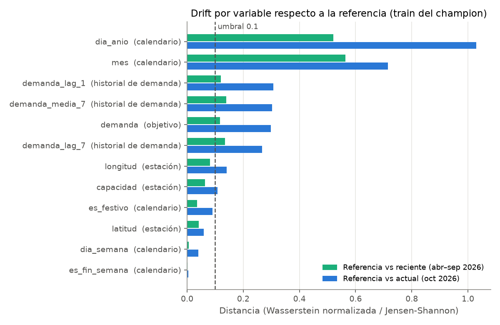
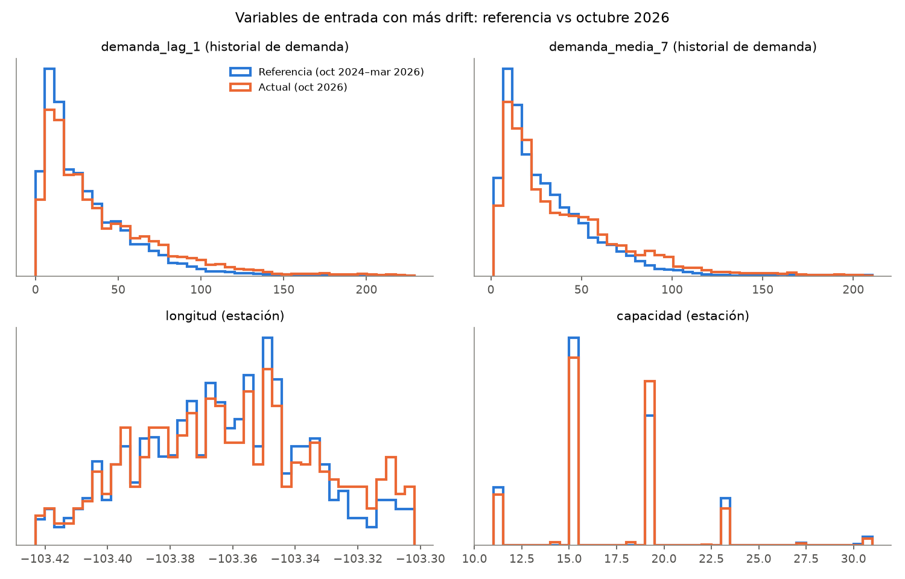
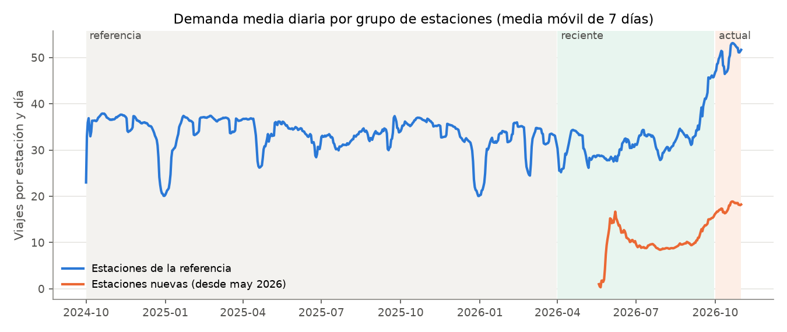
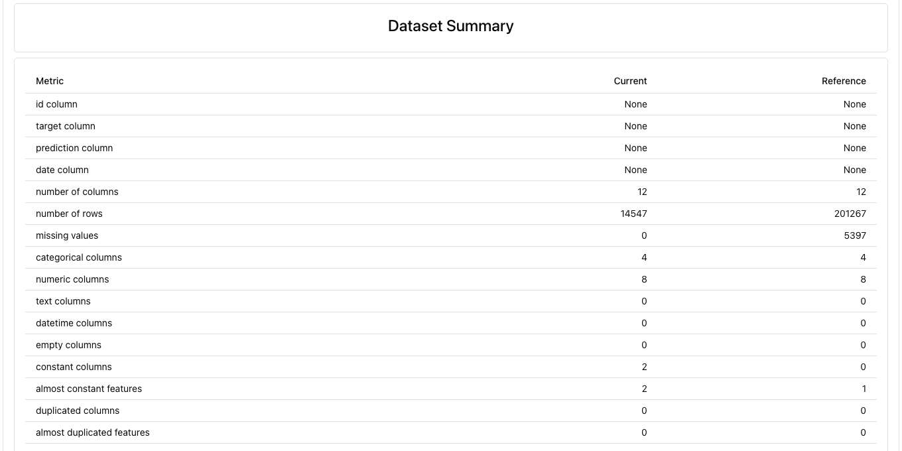

# Drift de datos del champion de P1 con Evidently (Entregable 8)

Evidencia del PR de LH3 (`feat/evidently-monitoring`). Compara los datos con los que se entrenó el
champion de P1 (`mibici-equipo16-p1-demanda`, versión 2) contra octubre de 2026, el primer mes
publicado después de todos los datos del proyecto. Los conjuntos son los de
[`docs/monitoring/contrato_datasets.md`](../../monitoring/contrato_datasets.md) (PR de CH1): se
reconstruyeron con `make monitoring-data` y sus huellas coinciden con
[`references/manifiesto_monitoreo.json`](../../../references/manifiesto_monitoreo.json)
(`827ffa8b5727`, `4f52f6556fe4` y `b511db2054b2`).

## Archivos

| Archivo | Contenido |
|---|---|
| [`reporte_referencia_vs_actual.html`](reporte_referencia_vs_actual.html) | **Reporte oficial de Evidently**: drift por variable, drift del objetivo y resumen de calidad (referencia vs octubre 2026) |
| [`reporte_referencia_vs_reciente.html`](reporte_referencia_vs_reciente.html) | Contexto: referencia vs abril–septiembre 2026 |
| [`drift_por_variable.csv`](drift_por_variable.csv) | Tabla ligera: comparación, variable, grupo, método, umbral, puntaje, decisión, medias, nulos y % fuera de lo visto en la referencia |
| [`resumen_drift.json`](resumen_drift.json) | Configuración, resumen por comparación, calidad de cada ventana, estaciones nuevas y comparación contra el mismo mes de años previos |
| [`grafica_drift_por_variable.png`](grafica_drift_por_variable.png) | Puntaje por variable con el umbral, abr–sep vs oct |
| [`grafica_distribuciones.png`](grafica_distribuciones.png) | Distribución de referencia vs octubre de las variables con más drift |
| [`grafica_demanda_diaria.png`](grafica_demanda_diaria.png) | Demanda diaria de estaciones de la referencia vs estaciones nuevas |
| [`captura_evidently_drift.png`](captura_evidently_drift.png), [`captura_evidently_calidad.png`](captura_evidently_calidad.png) | Capturas del HTML para el PDF |
| [`ejecucion.txt`](ejecucion.txt), [`pytest_evidently.txt`](pytest_evidently.txt), [`ruff.txt`](ruff.txt) | Salida de la corrida, de las 13 pruebas y del lint |

Los HTML se abren directo en el navegador (unos 4 MB cada uno, sin dependencias externas).

## Cómo se mide

- **Columnas monitoreadas:** las 11 variables de entrada del champion, con los tipos del contrato
  (4 categóricas y 7 numéricas). `estacion_id` y `fecha` son identificadores y no entran. La
  demanda observada (`demanda`) se mide aparte como **drift del objetivo** y no cuenta en la
  proporción de variables con drift.
- **Métodos fijos** (`mibici/config.py`): distancia de Wasserstein normalizada para numéricas y
  Jensen-Shannon para categóricas, con umbral 0.1 por columna; el conjunto tiene drift si al menos
  el 50 % de las variables lo tienen. Son las opciones que Evidently usa por defecto con más de
  1,000 filas; se fijan para que las pruebas con pocas filas usen la misma regla. Se prefieren a
  las pruebas de hipótesis (KS, chi cuadrada) porque con 201,267 filas cualquier diferencia mínima
  da un *p-value* pequeño: la distancia mide **cuánto** cambió la distribución, no si el cambio es
  estadísticamente distinguible.
- **Tres comparaciones**, todas contra la referencia (train del champion, oct-2024 a mar-2026):

| Comparación | Filas comparadas | Para qué |
|---|---|---|
| `referencia_vs_actual` | 14,547 (oct-2026, 470 estaciones) | Resultado oficial |
| `referencia_vs_reciente` | 76,947 (abr–sep 2026) | ¿El cambio ya existía antes de octubre? |
| `referencia_vs_actual_estaciones_conocidas` | 11,470 (oct-2026, las 370 estaciones que el champion vio) | ¿Cuánto del drift se debe a las estaciones nuevas? |

## Resultados



**Referencia vs octubre 2026: hay drift en el conjunto.** 7 de 11 variables superan el umbral
(63.6 %, por encima del 50 %), y el objetivo también tiene drift.

| Variable | Grupo | Puntaje oct | Media ref → oct | Puntaje abr–sep | Puntaje oct, solo estaciones conocidas |
|---|---|---|---|---|---|
| `dia_anio` | calendario | **1.029** | 183 → 289 | 0.520 | 1.029 |
| `mes` | calendario | **0.715** | — (todo es 10) | 0.564 | 0.715 |
| `demanda_lag_1` | historial de demanda | **0.307** | 33.5 → 44.0 (+31 %) | 0.120 | **0.512** (+52 %) |
| `demanda_media_7` | historial de demanda | **0.303** | 33.5 → 43.1 (+29 %) | 0.139 | **0.518** (+49 %) |
| `demanda_lag_7` | historial de demanda | **0.267** | 33.5 → 42.6 (+27 %) | 0.134 | **0.466** (+48 %) |
| `longitud` | estación | **0.141** | 3.8 % de filas fuera del rango de la referencia | 0.081 | 0.012 |
| `capacidad` | estación | **0.108** | 16.9 → 17.0 | 0.064 | 0.012 |
| `es_festivo` | calendario | 0.091 | 2.4 % → 0 % de días festivos | 0.035 | 0.091 |
| `latitud` | estación | 0.058 | — | 0.041 | 0.003 |
| `dia_semana` | calendario | 0.040 | — | 0.005 | 0.040 |
| `es_fin_semana` | calendario | 0.004 | — | 0.001 | 0.004 |
| **`demanda` (objetivo)** | objetivo | **0.298** | 33.5 → 43.7 (+31 %) | 0.117 (−11 %) | **0.501** (+51 %) |

Los valores salen de [`drift_por_variable.csv`](drift_por_variable.csv). En el periodo
abril–septiembre solo cambian el calendario y el historial de demanda (5 de 11, 45 %, sin drift del
conjunto) y la demanda **bajó** 11 %. Octubre es un cambio nuevo y en sentido contrario.



## Interpretación por grupo de variables

**1. Calendario (`mes`, `dia_anio`): cambio esperado, no es un problema de datos.** La ventana
actual es un solo mes, así que `mes` vale siempre 10 y `dia_anio` va de 274 a 304, mientras que
la referencia cubre 18 meses. Ese "drift" aparece con cualquier mes y no se puede corregir. Por
eso la estacionalidad se revisa de otra forma: comparando octubre contra los octubres anteriores
(punto 3). `es_festivo` queda cerca del umbral (0.091) porque octubre no tiene días festivos. El
modelo sí vio octubres en el entrenamiento (2024 y 2025), así que estas combinaciones no son nuevas
para él.

**2. Variables de estación (`longitud`, `capacidad`): se explican por completo por la expansión de
la red.** En octubre hay 100 estaciones que no existen en la referencia (99 empezaron a operar entre
mayo y agosto, y la 492 aparece el 24 de octubre). Representan el 21 % de las filas, contra el 12 % en abr–sep,
porque en octubre operan el mes completo. Al quitarlas, el drift de `longitud` baja de 0.141 a 0.012
y el de `capacidad` de 0.108 a 0.012, por debajo del umbral. Las nuevas estaciones se reparten por
toda la red (densifican zonas ya cubiertas), salvo 3 que quedan al oriente del límite de la
referencia (el 3.8 % de las filas con longitud fuera de rango). **Efecto esperado en P1:** el
champion nunca vio estas ubicaciones ni su nivel de demanda, que es mucho menor (17.7 viajes por
estación y día, contra 50.6 en las estaciones conocidas). Para ellas solo puede extrapolar desde
estaciones parecidas, y ese es el error que un reentrenamiento con abr–sep puede corregir.

**3. Historial de demanda y objetivo: cambio real de nivel, no estacional.** En las estaciones que el
champion conoce, la demanda de octubre de 2026 es de 50.6 viajes por estación y día, contra 36.8 en
octubre de 2024 y 36.6 en octubre de 2025 (**+37.9 %** contra el mismo mes de años previos, campo
`estacionalidad_demanda` del resumen). Ni la estacionalidad ni las estaciones nuevas lo explican:
estas *bajan* la media general, por eso el drift de demanda es mayor (0.51) cuando se excluyen. La
gráfica diaria muestra que el aumento empieza a mediados de septiembre y sigue durante octubre. Los
rezagos (`demanda_lag_1`, `demanda_lag_7`, `demanda_media_7`) cambian porque son la propia demanda
desplazada en el tiempo. Los datos no identifican la causa; son hipótesis posibles el crecimiento de
la red (más estaciones conectadas generan más viajes entre estaciones existentes), factores
externos no observados (clima, eventos, movilidad) o cambios en el servicio. **Efecto esperado en
P1:** los valores siguen dentro del rango que el modelo vio (menos del 0.6 % de los rezagos queda
fuera), y el modelo recibe los rezagos más altos, así que en parte se ajusta solo. El riesgo es que
la relación entre rezagos y demanda haya cambiado, o que se subestimen sistemáticamente los días
altos.



## Calidad de datos

Ningún indicador apunta a un problema de captura: el cambio se ve en datos limpios.

| Indicador | Referencia | Reciente | Actual (oct) |
|---|---|---|---|
| Filas / estaciones | 201,267 / 371 | 76,947 / 470 | 14,547 / 470 |
| Columnas faltantes o extra frente al contrato | 0 | 0 | 0 |
| Filas duplicadas / claves (`estacion_id`, `fecha`) duplicadas | 0 / 0 | 0 / 0 | 0 / 0 |
| Nulos | 5,397 (rezagos al inicio del historial de cada estación) | 0 | 0 |
| Tipos distintos a la referencia | — | 0 | 0 |
| Variables constantes | — | — | `mes`, `es_festivo` (esperado en un mes sin festivos) |
| Demanda negativa | 0 | 0 | 0 |

En los viajes crudos de octubre (manifiesto de CH1), de 635,532 viajes hay 0 duplicados, 1 con
una estación fuera del catálogo y 193 con duración inválida: la limpieza descarta el 0.03 %.



## Qué significa para el modelo y para el A/B

- **El drift no prueba por sí solo que el modelo empeoró.** La comprobación de CH1 da un MAE del
  champion de 8.12 en octubre contra 5.95 en abr–sep. Sin embargo, la demanda media también subió
  (43.7 contra 29.8), y en términos relativos el error es parecido (18.6 % contra 20.0 % de la
  demanda media). Corresponde al A/B de DH4 medir el desempeño con versiones fijas y separar el
  error por estaciones conocidas y nuevas.
- **Argumentos para el challenger (HH2):** reentrenar con referencia + reciente incorpora 4 meses de
  historial de las 99 estaciones nuevas y el nivel de demanda más reciente, sin tocar octubre. Esto
  ataca directamente el drift de las variables de estación. El aumento de octubre no aparece en
  ningún dato de entrenamiento permitido, así que el challenger tampoco lo habrá visto.
- **Insumo para Continuous Training (DH4):** como disparadores de reentrenamiento conviene usar el
  drift del objetivo y del historial de demanda (≥ 0.1) y la proporción de filas de estaciones
  nuevas, no la proporción global de columnas con drift: esta incluye el calendario, que siempre
  cambia con ventanas de un mes, y baja a 45 % justo cuando el drift de demanda es mayor (estaciones
  conocidas). En cualquier caso, la promoción debe depender de que el challenger mejore el MAE en
  la evaluación común.

## Limitaciones

- El umbral 0.1 es el valor por defecto de Evidently, no uno calibrado con la variación normal
  entre meses de MiBici. Como referencia, abr–sep ya supera el umbral en los rezagos (0.12–0.14).
- Las distancias no son pruebas de significancia ni dicen cuál es la causa. Las causas anteriores
  son hipótesis compatibles con los datos.
- Un solo mes de ventana actual: no se sabe si el nivel de octubre se mantiene.
- Las variables de estación se ponderan por filas estación-día: una estación nueva pesa 31 filas.
- No se calcula drift de predicciones: requiere las versiones fijadas del registry del equipo, que
  corresponden al A/B.

## Reproducir

```bash
python -m pip install -r requirements.txt        # incluye evidently==0.7.23
make monitoring-data                             # conjuntos de CH1 (o --sin-registry)
make monitoring-drift                            # o: python -m mibici.monitoring.evidently_report
python -m pytest tests/test_evidently_report.py -q
```

`--sin-html` omite los reportes HTML. `drift_por_variable.csv` y `resumen_drift.json` no llevan
fecha de ejecución: con los mismos conjuntos, una nueva corrida produce los mismos bytes (lo
verifica `test_generar_es_reproducible`).
