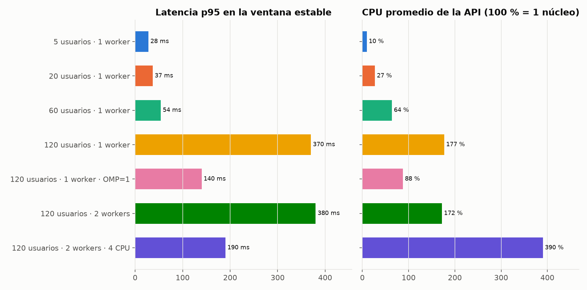

# Pruebas de carga de la API de P1 (Entregable 7 · PR #2 · LH3)

Locust contra `POST /predict` del stack de Docker Compose (PR #1), con CPU y RAM de los contenedores
medidas en la misma ventana. Los escenarios **oficiales para FinOps son `u05` y `u20`**; los demás
exploran dónde se degrada el sistema y qué cambio lo corrige.

## Condiciones comunes

| Elemento | Valor |
|---|---|
| Commit del código de carga | `e228ada` (rama `test/ops-locust`, sobre `main` = `0de5ff6` con el PR #1) |
| Modelo | `mibici-equipo16-p1-demanda` v1 del registry del stack, `origen = bundle`, `version_origen = 2` (champion), `run_id_origen = 86cc548d36e64f418d45ca053f11312a` |
| Endpoint y payload | `POST /predict`, **1 registro por petición** (1 petición exitosa = 1 predicción), rotando en orden fijo los 24 registros reales de oct-2026 de [`loadtests/payloads_p1.json`](../../../../loadtests/payloads_p1.json) |
| Éxito | HTTP 200 **y** `predicciones` = lista con un `float` finito > 0 **y** el modelo esperado. Un 200 con otra forma cuenta como fallido (`catch_response=True`) |
| Pausa entre peticiones | `between(0.5, 1.5)` s por usuario (~1 petición/s por usuario) |
| Duración | 60 s de calentamiento (se descarta) + **180 s de ventana estable** |
| Stack | API 1 worker, límite 2 CPU / 2 GiB; MLflow 1 CPU / 1 GiB (valores por defecto del Compose) |
| Máquina | Apple M4 Pro, 12 núcleos, 24 GiB, macOS 26.5.2; Docker Desktop 4.37.2 (engine 27.4.0), VM de 12 CPU y 7.65 GiB |
| Generador | Locust 2.47.0 **en el mismo host que el stack** (compite por CPU; Locust no emitió avisos de CPU alta) |
| Recursos | `docker stats` de `mibici-api-1` y `mibici-mlflow-1` cada ~3.3 s (54-56 muestras por ventana) |

> **Nota de entorno.** En esta máquina (chip M4 + Docker Desktop 4.37) `mlflow server` moría al
> arrancar con código 132 (SIGILL) dentro de `cryptography`/OpenSSL: la VM anuncia la extensión SME
> del procesador y el kernel de esa versión de Docker Desktop no la soporta. Se corrió con
> `OPENSSL_armcap=0` en los tres servicios, mediante un override local fuera del repo:
> no cambia el cómputo del modelo ni el tráfico HTTP de la prueba. Con Docker Desktop ≥ 4.38
> (Cristhian usó Docker 29.6) no hace falta.

## Resultados (ventana estable de 180 s)

| Escenario | Usuarios (spawn/s) | Config. API | Peticiones | Fallidas | Pred. exitosas | Peticiones/s | p50 / p95 / p99 (ms) | CPU API prom / p95 | RAM API máx | CPU / RAM MLflow |
|---|---|---|---|---|---|---|---|---|---|---|
| **u05** | 5 (1) | 1 worker, 2 CPU | 869 | 0 | **869** | 4.83 | 19 / 28 / 31 | 9.5 % / 19.9 % | 217 MiB | 3.1 % / 390 MiB |
| **u20** | 20 (2) | 1 worker, 2 CPU | 3,539 | 0 | **3,539** | 19.66 | 14 / 37 / 50 | 27.1 % / 37.7 % | 211 MiB | 2.8 % / 381 MiB |
| u60 | 60 (5) | 1 worker, 2 CPU | 10,601 | 0 | 10,601 | 58.89 | 16 / 54 / 91 | 63.8 % / 80.7 % | 211 MiB | 1.8 % / 386 MiB |
| u120 | 120 (10) | 1 worker, 2 CPU | 18,898 | 0 | 18,898 | 104.99 | 120 / 370 / 450 | 176.8 % / 201.3 % | 226 MiB | 2.6 % / 380 MiB |
| u120_w2 | 120 (10) | 2 workers, 2 CPU | 19,805 | 0 | 19,805 | 110.03 | 30 / 380 / 530 | 172.1 % / 214.6 % | 440 MiB | 2.5 % / 392 MiB |
| u120_w2_cpu4 | 120 (10) | 2 workers, 4 CPU | 20,114 | 0 | 20,114 | 111.74 | 51 / 190 / 300 | 390.3 % / 444.0 % | 443 MiB | 2.4 % / 387 MiB |
| u120_omp1 | 120 (10) | 1 worker, 2 CPU, `OMP_NUM_THREADS=1` | 20,678 | 0 | 20,678 | 114.88 | 27 / 140 / 240 | **87.6 %** / 115.5 % | 221 MiB | 2.9 % / 381 MiB |

CPU: 100 % = 1 núcleo. Tabla completa (con inicio y fin UTC de cada ventana):
[`resumen_escenarios.csv`](resumen_escenarios.csv). Gráficas en [`graficas/`](graficas/).



## Interpretación

1. **Hasta 60 usuarios (~59 peticiones/s) el sistema no se degrada.** Las peticiones atendidas
   crecen en proporción a los usuarios, la p50 se mantiene en 14-19 ms y la p95 sube de forma
   moderada (28 → 54 ms). La CPU de la API escala casi linealmente (9.5 % → 64 %). La RAM no
   cambia (~210 MiB): el modelo se carga una sola vez y no hay acumulación por petición.
2. **A 120 usuarios la API se satura por CPU.** La p50 se multiplica por 7 (120 ms) y la p95 por 7
   (370 ms). La CPU de la API promedia 177 % con p95 de 201 %, justo en el límite de 2 CPU del
   contenedor ([`recursos_api_escalamiento.png`](graficas/recursos_api_escalamiento.png)). Las
   peticiones atendidas (105/s) quedan por debajo de las ~118/s que ofrecerían 120 usuarios si la
   latencia fuera baja: como Locust es de lazo cerrado, cada usuario espera su respuesta antes de
   la pausa. No hubo errores: el sistema encola en lugar de fallar.
3. **MLflow no es cuello de botella.** Durante la carga usa ~2-3 % de CPU (picos de ~13 % por su
   health check) y ~380 MiB, igual que en reposo. La API carga el modelo al arrancar y no vuelve a
   consultar el registry.
4. **La causa raíz es la sobresuscripción de hilos, no el cómputo del modelo.** El champion es un
   `HistGradientBoosting`. Su `predict` usa OpenMP con un hilo por núcleo visible: dentro del
   contenedor `threadpoolctl` reporta **12 hilos de OpenMP y 12 de OpenBLAS**, aunque la cuota sea
   de 2 CPU. Con lotes de 1 registro, esos hilos consumen la cuota sin acelerar nada. Lo respaldan
   tres mediciones a 120 usuarios
   ([`latencia_optimizacion.png`](graficas/latencia_optimizacion.png),
   [`recursos_api_optimizacion.png`](graficas/recursos_api_optimizacion.png)):
   - **2 workers con la misma cuota** (`u120_w2`): baja la p50 (30 ms) pero no la p95 (380 ms),
     duplica la RAM (440 MiB) y la CPU sigue pegada al límite.
   - **2 workers y 4 CPU** (`u120_w2_cpu4`): la p95 baja a 190 ms, pero la API **consume casi las
     4 CPU (390 %) para la misma carga**. El consumo crece con la cuota, no con el trabajo.
   - **`OMP_NUM_THREADS=1` con 1 worker y 2 CPU** (`u120_omp1`): **CPU de 177 % → 88 %** (la mitad),
     p50 de 120 → 27 ms y p95 de 370 → 140 ms. Atiende toda la carga ofrecida (115 peticiones/s)
     con la misma RAM.
5. **Siguiente límite.** Con `OMP_NUM_THREADS=1` un solo proceso de Python ronda 1 núcleo (p95 de
   CPU 115 %) a ~115 peticiones/s. A partir de ahí el límite es el GIL de ese proceso, y ahí sí
   conviene combinarlo con `API_WORKERS=2`. **No se midió**; es lo siguiente por medir
   (ver abajo).

## Para FinOps (DH4)

- Usen **`u05` y `u20`** para el costo por inferencia: `manifiesto.json` de cada carpeta trae
  ventana UTC, duración, peticiones totales, fallidas y **predicciones exitosas** (iguales a las
  peticiones exitosas: 1 registro por petición), además de commit, modelo, máquina y recursos.
- Cifras medidas en local (M4 Pro), con el generador en el mismo host. En una VM de nube con vCPU
  x86 o compartidas el rendimiento por núcleo puede ser menor: declárenlo como extrapolación.
- Hallazgos de dimensionamiento con evidencia:
  - Con la configuración actual, ~60 peticiones/s usan ~0.65 núcleos en promedio (p95 0.8). La API
    cabe en una instancia de 1-2 vCPU y ~0.5 GiB para la API, más ~0.4 GiB para MLflow.
  - `OMP_NUM_THREADS=1` (y `OPENBLAS_NUM_THREADS=1`) en el servicio `api` **reduce a la mitad la CPU
    por petición**: es la optimización de mayor impacto, de costo cero y sin pérdida de exactitud
    (las predicciones no cambian). Propuesta para el Compose; se deja al equipo porque el archivo
    pertenece al PR #1.
  - Subir `API_WORKERS` sin fijar los hilos de OpenMP **duplica la RAM y no mejora la p95**. Darle
    más CPU sin fijar los hilos **consume toda la CPU extra**. Ninguna de las dos conviene por
    costo.
- Qué volver a medir antes de recomendar escalado: `OMP_NUM_THREADS=1` con 1 y 2 workers a 120,
  200 y 300 usuarios, y `API_CPUS=1` para validar la instancia de 1 vCPU.

## Reproducir

```bash
python -m pip install -r requirements-dev.txt            # incluye locust==2.47.0
make mlflow MLFLOW_PORT=5001                              # otra terminal: registry del equipo
make export-model MLFLOW_PORT=5001                        # champion a model_bundle/; luego Ctrl+C
docker compose up --build -d
curl -s "http://127.0.0.1:5001/api/2.0/mlflow/model-versions/get?name=mibici-equipo16-p1-demanda&version=1"
#   -> etiquetas "origen": "bundle", "version_origen": "2"

make carga-oficial                                        # u05 y u20 (~9 min) + gráficas
make carga ESCENARIO=u60 USUARIOS=60 SPAWN=5              # cualquier otro escenario
API_WORKERS=2 docker compose up -d api                    # variante con 2 workers
make carga-graficas                                       # regenerar gráficas y tablas
```

`run_escenario.sh` se niega a medir si el registry del stack no tiene `origen = bundle`
(`PERMITIR_MODELO_PRUEBA=1` para ensayos). La variante `u120_omp1` se corrió agregando
`OMP_NUM_THREADS: "1"` y `OPENBLAS_NUM_THREADS: "1"` al `environment` de `api` con un override de
Compose (`docker compose -f docker-compose.yml -f <override> up -d api`); el entorno quedó
registrado en [`u120_omp1/entorno_api.txt`](u120_omp1/entorno_api.txt).

## Archivos por escenario

| Archivo | Contenido |
|---|---|
| `manifiesto.json` | Commit, modelo (versión, origen y linaje), configuración real del contenedor, máquina, ventana UTC, conteos, latencias y recursos de la ventana |
| `ventana.json` | Límites de la ventana y conteos propios del locustfile (peticiones, fallidas y predicciones exitosas) |
| `locust_stats.csv`, `locust_failures.csv` | Estadísticas de Locust **solo de la ventana estable** (se reinician tras el calentamiento) |
| `locust_stats_history.csv` | Toda la corrida, una fila por segundo; los acumulados vuelven a 0 al reiniciar |
| `locust.html`, `locust_resumen.txt` | Reporte HTML y salida de consola de Locust |
| `recursos.csv` | `docker stats` de la API y MLflow durante toda la corrida, con timestamp UTC |
| `health.json`, `modelo_registry.json` | Estado de la API y versión del registry al iniciar la corrida |
