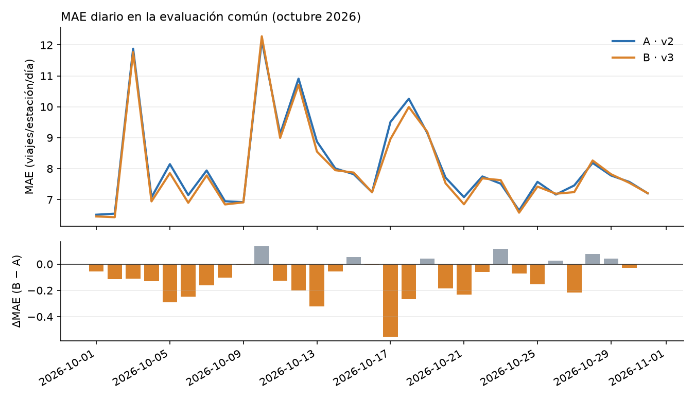
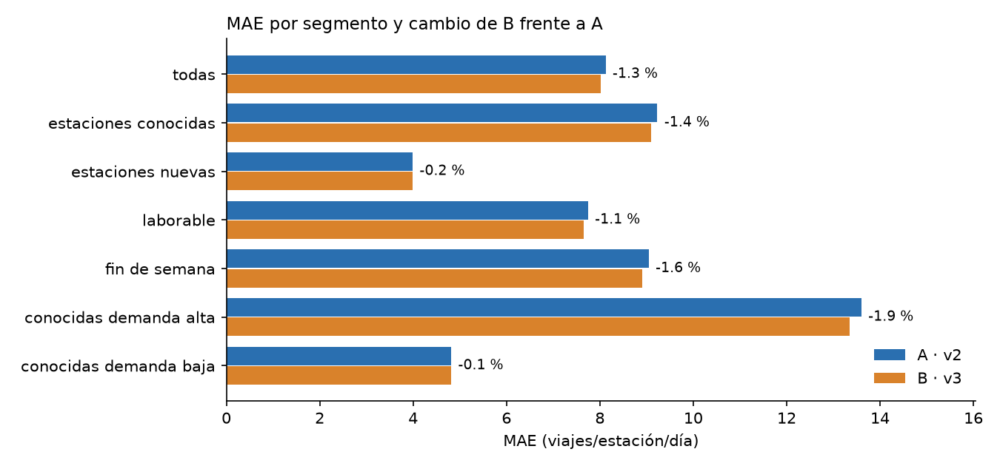
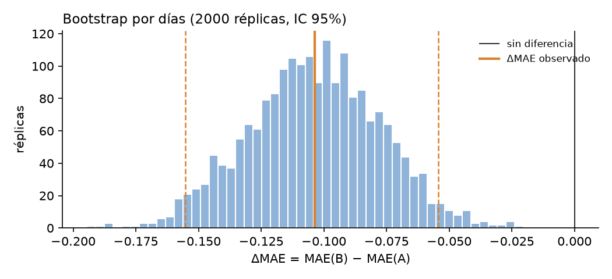

# A/B offline de P1 y recomendación de Continuous Training (Entregable 8)

Evidencia del PR de DH4 (`feat/abtest-reporte-final`). Compara dos versiones del modelo registrado
`mibici-equipo16-p1-demanda` sobre la evaluación común de octubre de 2026 y recomienda qué versión
debe quedar vigente. Los conjuntos son los del contrato de CH1
([`docs/monitoring/contrato_datasets.md`](../../monitoring/contrato_datasets.md)); se reconstruyeron
con `make monitoring-data` y sus huellas coinciden con el manifiesto (`827ffa8b5727`,
`4f52f6556fe4`, `b511db2054b2`). El drift que motiva el análisis es el de LH3
([`docs/evidencias/drift/README.md`](../../evidencias/drift/README.md)).

## Archivos

| Archivo | Contenido |
|---|---|
| [`tabla_ab.csv`](tabla_ab.csv) | Tabla del reporte: versión, corrida, ventanas, N, MAE, RMSE, desviación Poisson, sesgo y Δ contra A |
| [`ab_por_segmento.csv`](ab_por_segmento.csv) | MAE, RMSE y sesgo de A y B por segmento (estaciones conocidas/nuevas, laborable/fin de semana, demanda alta/baja) |
| [`ab_por_dia.csv`](ab_por_dia.csv), [`ab_por_estacion.csv`](ab_por_estacion.csv) | MAE de A y B por día (unidad del análisis pareado) y por estación |
| [`resultados_ab.json`](resultados_ab.json) | Versiones fijadas, métricas globales, intervalo bootstrap, pruebas pareadas, decisión y disparadores de CT |
| [`grafica_ab_mae_diario.png`](grafica_ab_mae_diario.png), [`grafica_ab_segmentos.png`](grafica_ab_segmentos.png), [`grafica_ab_bootstrap.png`](grafica_ab_bootstrap.png) | Gráficas para el PDF |
| [`captura_mlflow_registry_p1.png`](captura_mlflow_registry_p1.png) | Model Registry: versión 2 `champion`, versión 3 `challenger` y sus tags |
| [`ejecucion_ab.txt`](ejecucion_ab.txt), [`pytest_ab.txt`](pytest_ab.txt), [`ruff.txt`](ruff.txt) | Salida del challenger y del A/B, de las 31 pruebas y del lint |

## Versiones comparadas

| | Versión | Corrida | Entrenamiento | Qué es |
|---|---|---|---|---|
| **A · champion** | 2 | `86cc548d…` | 2024-10-01 a 2026-03-31 (201,267 filas, 371 estaciones) | HGB Poisson, `learning_rate` 0.05, `max_iter` 100, `max_leaf_nodes` 63 |
| **B · challenger** | 3 | `658257aa…` | 2024-10-01 a 2026-09-30 (278,214 filas, 470 estaciones) | La misma receta reentrenada con la ventana reciente |

B solo cambia la ventana de entrenamiento, así que la diferencia mide el efecto de reentrenar con
datos recientes (la pregunta de Continuous Training) y no el de otro algoritmo. Los
hiperparámetros se eligieron en la validación original (abr–jun 2026); nadie usó octubre para
entrenar ni elegir nada.

**Registry local reconstruido.** El registry del equipo vive en un `mlflow.db` local de otra
máquina. Para correr el A/B con versiones del mismo registry, la versión 2 se reconstruyó aquí con la
misma receta, datos (`4d8c2a1292fc`) y semilla; el entrenamiento es determinista y reproduce las
métricas documentadas del champion oficial (corrida `47933c5b…`): `val_mae` 6.1367 y MAE de
octubre 8.12, igual que la comprobación de CH1. En el registry del equipo, el challenger quedará
como la siguiente versión libre; `ab_compare` resuelve los aliases a números, así que el comando
no cambia.

**Verificación previa sin octubre.** Antes del ajuste final, `challenger_p1` entrena la misma
receta con referencia + abr–jun y la evalúa en jul–sep frente al champion: MAE 5.795 → 5.761
(+0.58 %). Reentrenar ayudaba fuera de muestra antes de tocar la evaluación común.

## Método

- **Mismas filas:** A y B predicen las 14,547 filas estación × día de octubre de 2026 (470
  estaciones, 31 días); el código falla si los tamaños no coinciden.
- **Métricas:** MAE (principal, viajes por estación y día), RMSE, desviación Poisson, sesgo
  (media de ŷ − y) y MAE relativo a la demanda media.
- **Comparación pareada:** cada fila se evalúa con ambos modelos. La incertidumbre de ΔMAE = MAE(B)
  − MAE(A) se estima con 2,000 réplicas de **bootstrap por bloques de días** (se remuestrean días
  completos), porque las filas de un mismo día comparten clima, eventos y calendario. Tratarlas
  como independientes daría un intervalo falsamente estrecho. Como apoyo: proporción de días y
  estaciones donde gana B y prueba de Wilcoxon sobre los 31 MAE diarios.
- **Regla de decisión** (`decidir`): promover B si reduce el MAE con IC 95 % por debajo de 0 y
  pasa las guardas (RMSE no peor; ningún segmento empeora más de 2 %). Conservar A si B empeora o
  falla una guarda. Recoger más datos si el IC incluye el 0.
- **No es un A/B online.** No hubo tráfico aleatorizado entre variantes ni efecto de las
  predicciones sobre la operación. Es una comparación offline controlada sobre datos históricos
  posteriores, el paso previo a un shadow o canary.

## Resultados

| Modelo | Versión MLflow | Evaluación (mismo N) | MAE ↓ | RMSE ↓ | Desv. Poisson ↓ | Sesgo | Δ MAE vs A |
|---|---|---|---|---|---|---|---|
| A · champion | 2 | oct-2026, 14,547 | 8.122 | 17.500 | 3.227 | −1.58 | — |
| B · challenger | 3 | oct-2026, 14,547 | **8.018** | **16.852** | **3.128** | −1.33 | **−0.104 (−1.27 %)** |

| Evidencia pareada | Valor |
|---|---|
| ΔMAE (B − A) e IC 95 % bootstrap por días | −0.104 [−0.155, −0.054] (−1.9 % a −0.6 %) |
| Réplicas con B mejor | 100 % de 2,000 |
| Días donde B tiene menor MAE | 23 de 31 (Wilcoxon p = 0.0004) |
| Estaciones donde B tiene menor MAE | 244 de 470 |



| Segmento | N | Demanda media | MAE A | MAE B | Δ MAE |
|---|---|---|---|---|---|
| Estaciones conocidas | 11,470 | 50.6 | 9.230 | 9.101 | −1.40 % |
| Estaciones nuevas (no vistas por A) | 3,077 | 17.7 | 3.988 | 3.981 | −0.17 % |
| Laborable | 10,323 | 48.2 | 7.744 | 7.656 | −1.14 % |
| Fin de semana | 4,224 | 32.6 | 9.044 | 8.903 | −1.56 % |
| Conocidas, demanda alta | 5,766 | 79.8 | 13.599 | 13.347 | −1.86 % |
| Conocidas, demanda baja | 5,704 | 21.2 | 4.814 | 4.809 | −0.11 % |



## Interpretación

1. **B es mejor de forma consistente, pero la mejora es pequeña.** El intervalo excluye el 0 y B
   gana en todos los segmentos, así que la mejora no se debe a unos pocos días. En magnitud son
   0.1 viajes por estación y día (−1.3 % de MAE, −3.7 % de RMSE). La regla pide reducción con
   evidencia, no un tamaño mínimo, y B es la misma receta con más datos, así que promoverla tiene
   poco riesgo. Aun así, no hay que venderla como un cambio grande.
2. **La mejora viene de las estaciones conocidas con demanda alta, no de las nuevas.** El drift de
   `longitud` y `capacidad` se debe a las 100 estaciones nuevas, y se esperaba que el challenger
   ganara ahí. No fue así: en las nuevas ambos modelos tienen casi el mismo error (3.99 vs 3.98)
   porque las variables de rezago (`demanda_lag_*`) ya informan a A del nivel de cada estación. El
   drift de estación tuvo poco impacto en el desempeño, un ejemplo de que *drift no implica
   degradación*. Donde B sí ayuda es en las estaciones de alta demanda, cuyo nivel cambió en
   abr–sep (−11 %) y sube en octubre (+38 % contra octubres previos). B reduce ahí el sesgo de −3.79
   a −3.31.
3. **El problema de fondo sigue presente.** Ambos modelos subestiman octubre (sesgo −1.58 y −1.33)
   porque el aumento de nivel no está en ningún dato de entrenamiento permitido. Los peores días
   (3, 10 y 12 de octubre) tienen el mismo error alto en A y en B. Son días de demanda atípica que
   el calendario y los rezagos no anticipan, y reentrenar con abr–sep no los corrige.
4. **El MAE absoluto exagera la degradación.** El MAE del champion pasa de 5.79 (jul–sep) a 8.12
   (+40 %), pero la demanda media pasa de 30.1 a 43.7 (+45 %). En relación con la demanda, el error
   *baja* de 19.3 % a 18.6 %. El modelo no se descompuso: atiende un nivel de viajes más alto,
   con un error proporcional similar.



## Recomendación y Continuous Training

**Decisión: promover la versión 3 a `champion`.** Se justifica por la mejora consistente con
intervalo por debajo de 0, la ausencia de segmentos que empeoren y el bajo riesgo (misma receta y
firma, la API no cambia). El alias **no se mueve en este PR**: el paso siguiente es un periodo
corto de shadow (B en paralelo sin servir) o canary, y luego mover el alias en el registry del
equipo. La versión 2 queda disponible para rollback inmediato.

**Política de reentrenamiento** (`politica_continuous_training`, resultado en
`resultados_ab.json`). Separa *cuándo entrenar* de *cuándo promover*:

| Disparador | Valor oct-2026 | Umbral | ¿Activo? |
|---|---|---|---|
| Problemas de calidad (columnas faltantes, duplicados, demanda negativa) | 0 | > 0 bloquea el entrenamiento | No |
| Drift del objetivo (Wasserstein, Evidently) | 0.298 | ≥ 0.1 | Sí |
| Variables de historial de demanda con drift | 3 | ≥ 1 | Sí |
| % de filas de estaciones no vistas por el modelo | 21.2 % | ≥ 10 % | Sí |
| Aumento del MAE **relativo** del champion vs su periodo base | −3.6 % | ≥ 15 % | No |

Acción: **`reentrenar_candidato`** (hay cambio en la demanda y estaciones no vistas, con datos
limpios). La degradación se mide con el MAE relativo: con el absoluto (+40 %) la alerta saltaría
solo porque hay más viajes. La proporción global de columnas con drift no se usa como disparador
porque incluye `mes` y `dia_anio`, que siempre cambian con ventanas de un mes.

Esquema propuesto:

1. **Mensual, al publicarse cada mes de MiBici:** `make monitoring-data` → `make monitoring-drift`
   → política de CT. Si los datos tienen problemas, se corrige el pipeline antes de entrenar.
2. **Si la política pide reentrenar:** entrenar un candidato con todo lo publicado hasta el mes
   anterior (`make monitoring-challenger`) y registrarlo con alias `challenger`.
3. **Promoción gobernada:** A/B en el mes nuevo (`make monitoring-ab`). Solo `promover_challenger`
   habilita mover el alias, con aprobación humana y shadow o canary previo. Con
   `recoger_mas_datos` se repite al mes siguiente; con `conservar_champion` se investiga la causa.
4. **Siguiente experimento:** incorporar octubre en cuanto se use como entrenamiento (para medir en
   noviembre) y probar variables que capten el cambio de nivel (`demanda_media_28`, ya disponible
   como `features=v2`) o señales externas (clima, eventos). El sesgo negativo indica que el modelo
   reacciona tarde a los cambios de nivel.

Los umbrales son puntos de partida, no valores calibrados. Abr–sep ya supera 0.1 en los rezagos, así
que hay que ajustarlos con varios meses de historia para no reentrenar por variación normal.

## Limitaciones

- Un solo mes de evaluación (31 bloques): el intervalo es válido para octubre, no garantiza que la
  ventaja se mantenga.
- El bootstrap por días respeta la correlación dentro del día, pero no la que hay entre días
  consecutivos. Con un efecto tan consistente (23 de 31 días), la conclusión no cambia.
- El A/B mide error de predicción, no impacto operativo (rebalanceo, estaciones vacías). Eso
  requiere una prueba online.
- Las versiones se reconstruyeron en un registry local (ver arriba); la corrida oficial en el
  registry del equipo debe reproducir estas cifras porque el entrenamiento es determinista.

## Reproducir

```bash
make mlflow                                     # servidor en otra terminal
export MLFLOW_TRACKING_URI=http://127.0.0.1:5000
make monitoring-data                            # conjuntos de CH1 (mismas huellas)
make monitoring-drift                           # reporte de Evidently de LH3 (resumen_drift.json)
make monitoring-challenger                      # versión nueva de P1 con alias challenger
make monitoring-ab                              # A/B: escribe esta carpeta y una corrida de análisis
python -m pytest tests/test_ab_compare.py tests/test_challenger_p1.py -q
```

`resultados_ab.json` y los CSV no llevan fecha de ejecución: con las mismas versiones y conjuntos,
una nueva corrida produce los mismos valores (`test_guardar_escribe_tablas_graficas_y_resumen_sin_fecha`).
