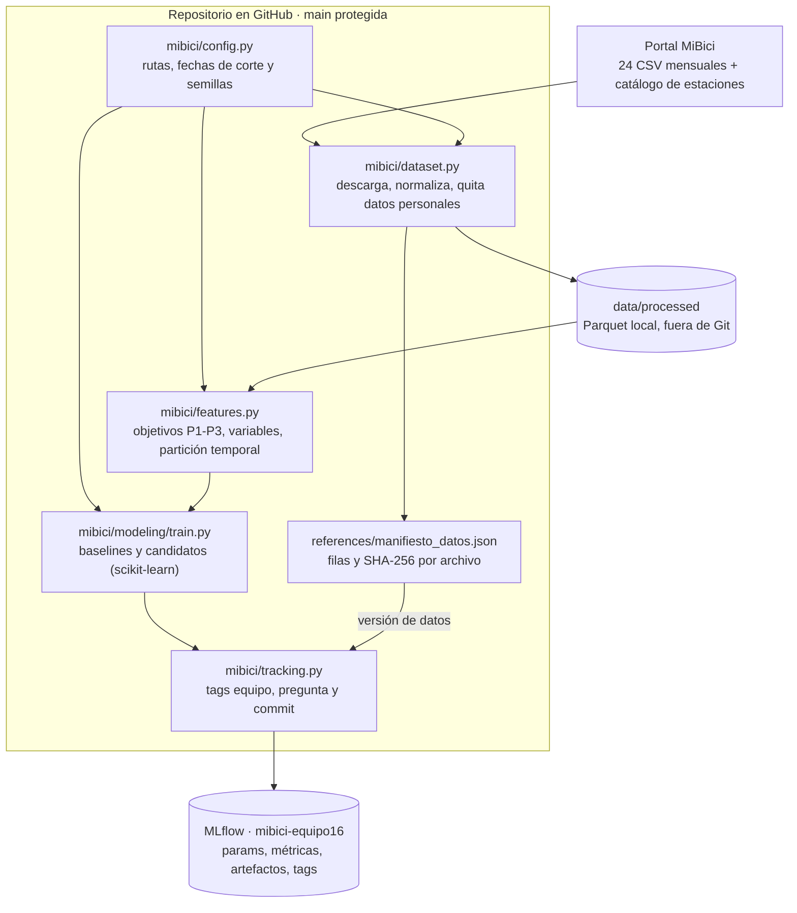

# Arquitectura — MiBici (Equipo 16)

Arquitectura local y por lotes: los scripts del repositorio llevan los datos del portal a MLflow, y
`mibici/config.py` fija qué datos, fechas y semillas usa cada run.

| Herramienta | Uso | Por qué |
|---|---|---|
| Git y GitHub | Código, PRs y revisión con `main` protegida | Trazabilidad de cada cambio y revisión por pares (GitHub Flow) |
| Cookiecutter Data Science | Estructura del repositorio | Convención conocida: cada cosa tiene un lugar |
| pandas y Parquet (pyarrow) | Lectura de CSV y almacenamiento normalizado | Formato columnar con tipos y compresión; más rápido que CSV |
| Manifiesto con `hashlib` | Versión de los datos | Detecta cualquier cambio en los datos sin servidor adicional |
| scikit-learn | Baselines, modelos y métricas | Interfaz única para modelos, `Dummy*` y métricas de evaluación |
| MLflow Tracking | Runs con params, métricas, artefactos y tags | Compara runs y los liga a una versión de datos y un commit |
| typer, loguru, ruff, pytest | Terminal, registro, estilo y pruebas | Vienen con la plantilla; ejecución sin pasos manuales |
